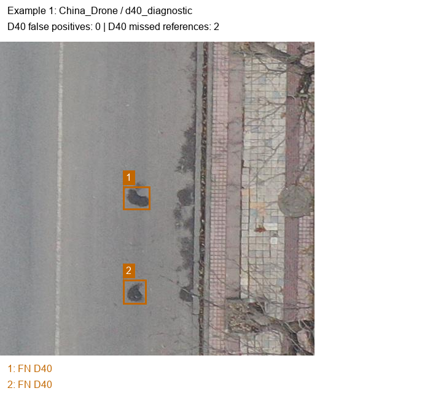
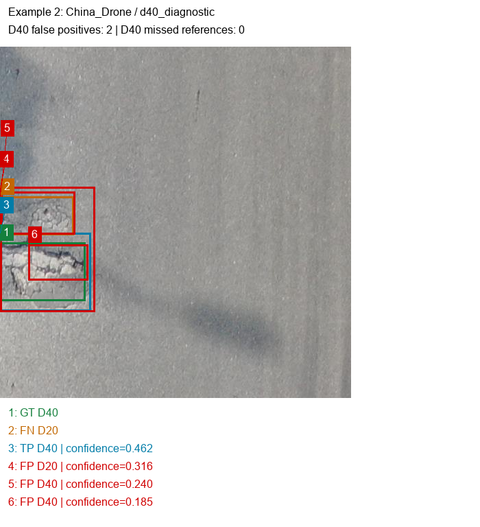
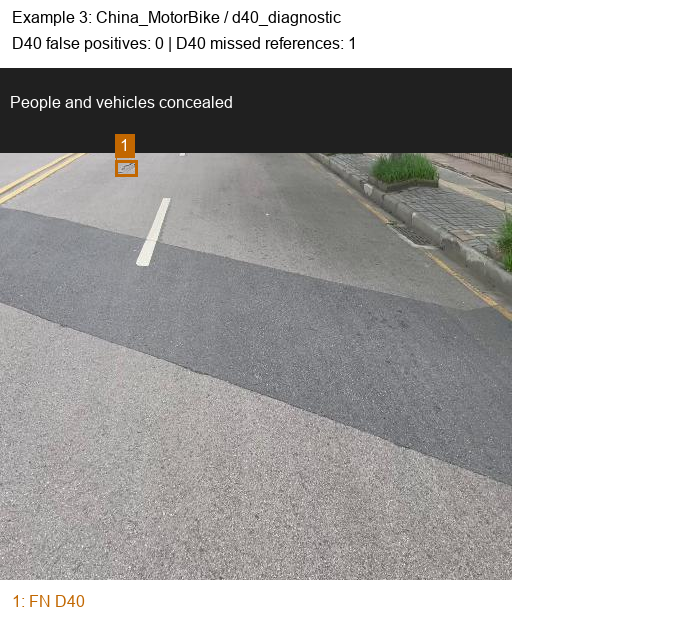
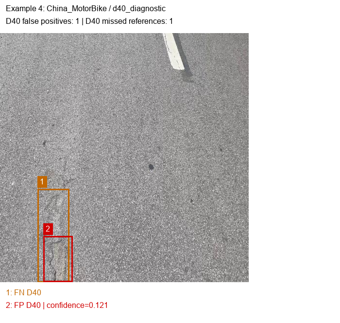
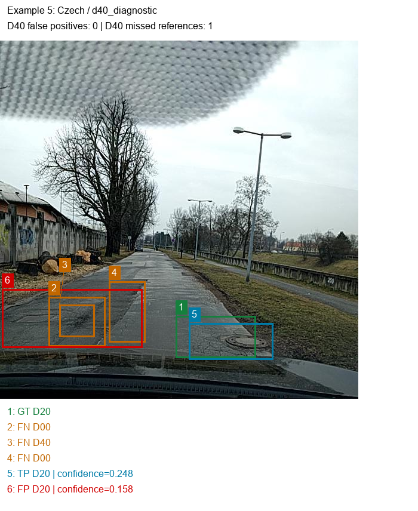
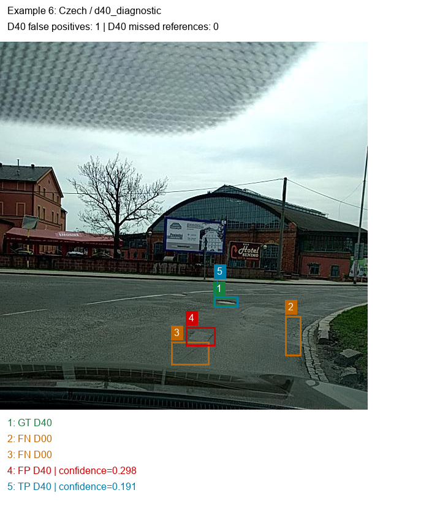

# Presentation Failure Gallery

GT: matched reference; FN: missed reference;
TP: matched prediction; FP: unmatched prediction.

Matching uses same-class IoU >= 0.50.
These selected development examples do not estimate deployment frequency.

## Example 1: China_Drone

## Example 2: China_Drone

## Example 3: China_MotorBike

## Example 4: China_MotorBike

## Example 5: Czech

## Example 6: Czech

